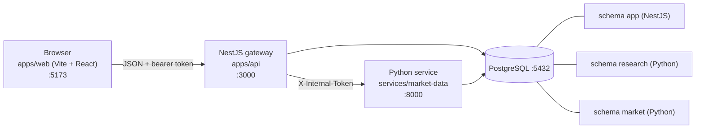

# System overview (after Sprint 08)



| Part | Folder | Port | Owns | Never does |
|---|---|---|---|---|
| Web app | `apps/web` | 5173 | pages, charts, words | compute scores, hold identity before the reveal |
| Gateway | `apps/api` | 3000 | schema `app` (learners, `learner_episode`, `learner_study`, glossary, lessons and progress, durable limits and trace), logins, validation | compute any number |
| Python service | `services/market-data` | 8000 | schemas `market` and `research`, all data and scores, Swagger for every function | handle users or passwords |
| PostgreSQL | native Windows service | 5432 | the three schemas | |

**Strategy Lab data flow (Sprint 07).** `POST /lab/studies` (gateway: ownership row in `app.learner_study`, at most 20 studies per learner) -> Python `create_lab_study` (practice end fixed, vault locked) -> `POST /lab/studies/:id/runs` (validate, ownership, 20 runs a minute) -> Python `run_practice` (practice bars only, adjusted as of the practice end; rule, buy and hold, cost table, luck check, one trial) -> whitelisted reply with at most 300 chart points -> `POST /lab/studies/:id/vault` (type OPEN, `confirm: true`, 3 tries a minute) -> Python `open_vault` (one use) -> vault numbers. Decision record: ADR 0017; what the page shows: `lab.md`.

**Lessons data flow (Sprint 08).** `GET /lessons` and `GET /lessons/:slug` (gateway only; option texts, no answer key) -> `POST .../steps/:n/read` (idempotent upsert into `app.lesson_progress`) -> `POST .../questions/:n/answer` (limit 60 a minute checked in `app.rate_event`; verdict looked up from `app.lesson_question`; attempt appended to `app.quiz_answer` with the lesson version; the right option is returned only when the answer was right or after the second wrong answer). Python is not involved. **Durable limits:** login, Lab runs, vault tries and lesson answers are counted in PostgreSQL in one transaction with an advisory lock, so they survive a restart and two simultaneous calls cannot both take the last slot; the request trace is stored in `app.request_log`. Decision record: ADR 0018; lessons: `lessons.md`.

**Indicators and decisions data flow (Sprint 09).** `GET /episodes/:id/indicators` and `POST|GET /episodes/:id/decisions` (gateway: ownership through `app.learner_episode`, the same 404 for unknown and foreign ids, 30 decisions a minute through the durable limiter) -> Python `indicator_for_episode` (days 1..cursor only, numbers only) and `record_decision` / `journal` (append-only `research.paper_decision`, results recomputed from the rows and the visible closes) -> whitelisted reply. Decision record: ADR 0019; what the screens show: `journal.md`.

**Request path:** browser -> gateway (token, ownership, validation) -> Python (work) -> gateway (whitelist the answer, map errors) -> browser. The Python Learning endpoints demand `X-Internal-Token` when `INTERNAL_API_TOKEN` is set, so the browser path is the only path. **Contracts:** `docs/02-domain/openapi-market-data.json` (Python) and `docs/02-domain/openapi-gateway.json` (gateway) are committed and checked by tests; the web and gateway TypeScript types are generated from them.

## Start everything (three terminals)
```bash
# 1. Python service (from services/market-data)
.venv/Scripts/python.exe -m market_data.cli serve            # or: uv run market-data serve
# 2. Gateway (from apps/api)
npm ci && npm run build && npm run migrate:up && npm run seed:glossary && npm run seed:lessons && npm start
# 3. Web app (from apps/web)
npm ci && npm run dev                                          # http://127.0.0.1:5173
```
Swagger: Python `http://127.0.0.1:8000/docs`, gateway `http://127.0.0.1:3000/docs`.

## Secrets and keys (names only; values live in the git-ignored `.env`)
`DATABASE_URL`; `ALPACA_API_KEY_ID`, `ALPACA_API_SECRET_KEY`, `TIINGO_API_KEY`, `FRED_API_KEY` (data downloads only); `JWT_SECRET`, `INTERNAL_API_TOKEN` (generated locally, Sprint 06). Generate a value with `node -e "console.log(require('crypto').randomBytes(32).toString('hex'))"`. Placeholders are in `.env.example`.

## Tests
Python: `.venv/Scripts/python.exe -m pytest tests` (set `TEST_DATABASE_URL` for database tests). Gateway: `npm test` in `apps/api` (needs `TEST_DATABASE_URL`; the end-to-end spec starts the real Python service on a free port). Web: `npm test` in `apps/web`; `npm run build` type-checks everything.

## Licence note
Tiingo's free plan is "Internal Use Only": run the stack on this machine only and do not show the real charts to other people. The FRED notice is shown wherever FRED-derived numbers appear.
